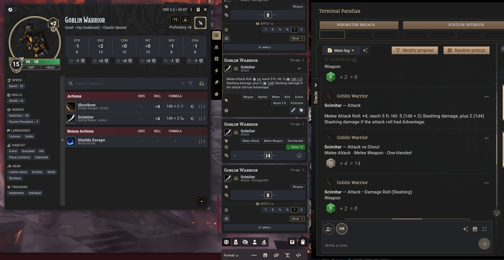
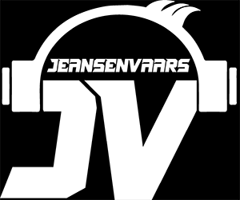

    
# JV's PUM Companion Bridge for Foundry VTT

Roll from your Foundry sheets, and the results land in your [PUM Companion](https://jeansenvaars.itch.io/plot-unfolding-machine) journal. Works with any game system.

**Foundry VTT v14** · requires the **PUM Companion** desktop app (Windows, macOS or Linux)

### _Created by: JeansenVaars_
#### [This module was made for free, with joy, long nights and because my solo journal wanted my Foundry dice, so tons of coffee :D!](https://ko-fi.com/jeansenvaars)

**A character sheet and its chat cards in Foundry (left), and the same rolls in the PUM Companion journal (right)**

## What it does

PUM Companion connects to your Foundry world on its own and already picks up plain chat and basic rolls. Most game systems, though, put their results in their own chat cards, and those only exist once Foundry draws them in a browser. This module is what reads them.

With the module on, each public chat card reaches the PUM Companion journal with:

* **The full card text**, as your game system writes it: attacks, damage, hit locations, item cards, and everything else
* **Who said it**: the speaking character and the player behind it, matched to your PUM Companion characters by name
* **Card pictures** (optional, switched on in the app): the card exactly as Foundry draws it, with its fonts, colors and dice icons
* **Card formats** (optional): a per-system format, written in the app or by its AI Assistant, that turns a card into tidy Markdown

Edits in Foundry follow along. A re-rolled or pushed card updates its journal entry, unless you already edited that entry yourself.

## Installation

1. In Foundry, open **Add-on Modules → Install Module**, and search for **PUM Companion Bridge**, or paste this manifest URL:
   `https://github.com/saif-ellafi/foundryvtt-pumc-bridge/releases/latest/download/module.json`
2. Enable **PUM Companion Bridge** in your world
3. In your world, create a user for PUM Companion, with a password
4. In PUM Companion, open **Settings → Integrations**, turn on **Connect to Foundry VTT**, and enter the server address, that user and its password

The module does its work in the browser of whoever posts a card, so keep Foundry open in a browser while you play. If you play alone, that's you.

## Privacy

* Nothing leaves your Foundry server: the module talks to PUM Companion through Foundry's own connection, and contacts no other server
* Only public messages are sent. Whispers and blind rolls stay out
* Pictures are only made while PUM Companion asks for them

## By JeansenVaars

## Check out my other modules!
* [Window Controls](https://github.com/saif-ellafi/foundryvtt-window-controls)
* [Minimal UI](https://github.com/saif-ellafi/foundryvtt-minimal-ui)

## Appreciations
* Thanks to [html-to-image](https://github.com/bubkoo/html-to-image) by bubkoo, bundled under its MIT license, which draws the card pictures
* Thanks to the PUM Companion players who asked for their Foundry dice in their journals

## License
[MIT License](./LICENSE.md)

## Powered By

Thanks to JetBrains I can work on this project using **WebStorm**.
